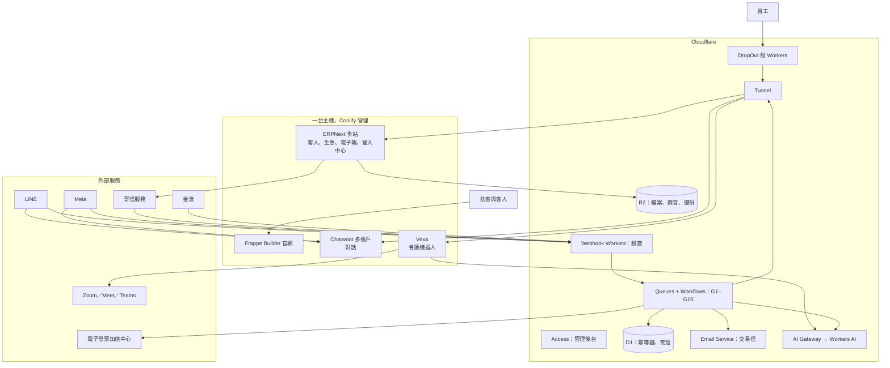

# EveryThingOS 架構

狀態：第二版。產品外殼已落地（`web/`）；後端依第 11 節分期接上。第 0.3 節是第二輪決策，未被推翻前以它為準  
商業：每年 NT$100,000 未稅，免費顧問導入，全模組套琢奧識別  
對象：要把對話、電子報、客人、生意、會議紀錄編成**登入一次就能做完所有事、可賣給各產業的一套作業系統**的決策者與實作者

---

## 0. 決策紀錄（五題第一輪）

這些答案會綁住後面每一個技術選擇。之後若改，改這裡，不要只改程式。

| # | 問題 | 第一輪答案 | 對架構的強制後果 |
| --- | --- | --- | --- |
| 1 | 第一批服務哪種生意？ | **混合／全產業** | 核心必須是水平平台，產業差異用「產業包」開關，禁止把某一行的欄位寫死進核心 |
| 2 | 自用還是要賣？ | **自己先用、驗證後再賣** | 第一天就用「一公司一站」的租戶模型；先不要做計費，但不要做成無法複製的單機特例 |
| 3 | 員工每天住哪個畫面？ | **必須能控制主畫面 Dashboard，以及公司自己的業務流程** | 儀表板與流程引擎是平台能力，不是我們替所有客戶選死 A/B/C |
| 4 | 台灣獲客主通道？ | **Email、LINE 之外，還有社群媒體與官方網站** | 通道是可插拔適配器。官網第一期就要在產品裡；社群與 LINE 走同一套 UTM／短網址／事件，不要各做各的 |
| 5 | 第一期「一筆生意」完成定義？ | **要有彈性；目標是像 Odoo 一樣強、一樣廣，甚至更好** | 預設提供一條可跑通的範本閉環，但階段、欄位、是否出貨／是否收款，全部可依公司設定 |

一句話消化：EveryThingOS 不是「幫某一家公司做進銷存」，而是做 **Odoo 級的廣度，但四支柱都在開源裡、而且儀表板與流程可由每家公司自己控**。產品名對外是 **DropOut OS**，全畫面套琢奧 logo 與識別。

---

## 0.1 商業與套皮（已寫進產品）

| 項目 | 決定 |
| --- | --- |
| 年費 | NT$100,000 未稅／公司／年，含全模組 |
| 導入 | 免費顧問，含在年費，不另開導入專案 |
| 產業 | 100 個產業包（`web/data/industries.json`），導入時打開一包再改例外 |
| 識別 | 員工只看到 DropOut；主題在 `branding/` |
| 進銷存等級 | 對齊鼎新 A1 與億看 ECOUNT：報價到收款、採購、庫存、帳齡、傳票、營業稅、電子發票適配 |
| 更好用 | 現場語言、產業包藏欄位、今天三件事；不把 200 個程式名稱丟給倉管 |
| 人頭費／模組加購 | 不收 |

---

## 0.2 對齊鼎新 A1／億看 ECOUNT，但更好用

目標等級是台灣中小企業會拿來管進銷存與帳的兩套雲端系統，不是 SAP。能力必須對得上，操作必須比它們直觀。

**對得上（不能少）：**

- 報價 → 訂單 → 出貨／履行 → 發票 → 收款
- 請購 → 進貨 → 入庫 → 應付 → 付款
- 多倉、安全庫存、盤點；批號／BOM 用產業包打開
- 應收帳齡、沖帳、進銷存拋轉傳票、損益
- 台灣營業稅 5%、統編；電子發票走加值中心適配，不自研財政部連線

**更好用（這才是取代理由）：**

1. **現場語言**：員工看到「客人在問／答應要了／請他付錢」，括號才寫會計名詞。不必先背「銷貨單」「收款單」。
2. **一張單一個下一步**：點按鈕，同一張單往前走。不要為了出貨再開一個程式。
3. **今天三件事**：老闆先選行業。打開工作區看到的是這一行動現場最痛的事，以及這一行動自己的步驟，而不是別人的催收與發票。
4. **用不到的藏起來**：服務業產業包關掉倉庫；書店看不到效期；買賣業看不到 30 段工單。
5. **一張客人卡片**：A1、億看都沒有的對話、電子報、會議紀錄，全部回到同一個客人

產品殼 `web/app/workspace/erp/*` 用示範帳簿證明這套操作。**過帳權威仍是 ERPNext**；殼還沒接 live site 時，畫面上必須寫清楚，不可假裝已經過帳。

完整對照表在產品裡：`/saas` 與 `/workspace/erp/compare`。

---

## 0.3 第二輪決策（大整合後）

依 [PLATFORM-INTEGRATION.md](PLATFORM-INTEGRATION.md) 的重複造輪子檢查與查證。每題的理由與替代方案寫在那份文件；這裡只記結果。

| # | 決定 | 取代 |
| --- | --- | --- |
| P1 | 殼是**薄殼**：今天、客人卡片、一鍵下一步、全域搜尋；深度操作跳進原系統 | 殼重做每個系統的畫面 |
| P2 | 系統間同步用 Cloudflare Workers + Queues + Workflows | Activepieces |
| P3 | 電子報用 ERPNext Email Campaign；寄送、開信、點擊、退信走外部寄信服務；需要計分時才加 Mautic | 每家公司一套 Mautic + Postal |
| P4 | ERPNext 當登入中心；Chatwoot 經 Platform API 一次性登入網址；Cloudflare Access 擋管理後台 | Keycloak |
| P5 | 會議紀錄用 Vexa：接行事曆，自己進 Zoom／Google Meet／Teams | 新增 |
| P6 | Cloudflare 當前門與膠水，一台主機跑有狀態系統，Tunnel 相連 | 未定 |
| P7 | 清庫用雙重確認訂閱 + 退信停寄 | Reacher |
| P8 | 留言轉私訊先用 Meta Business Suite 內建 | OpenReply 必裝 |
| P9 | 主機用 Coolify 管理 | 手寫 Compose |
| P10 | 電子發票用 paid-tw/einvoice（MIT） | 自寫適配器 |

第 0 節五題的答案不變；第二輪只換「用什麼做」，不換「要做什麼」。

---

## 1. 產品定位

員工打開一個網址、登入一次，就能回客人訊息、發電子報、跟進客人、走完報價到收款、拿到會議紀錄。底下是開源系統分工，上面是 DropOut 薄殼。

殼只負責兩件事：**下一件事是什麼**、**這個人是誰**。需要完整工具時（回訊息、對帳、改科目），在同一個登入裡打開那個工具的那一頁，套 DropOut 皮。殼不跟原系統比功能多。

要比 Odoo 更好的地方仍是：

1. 沒有社群版／企業版功能牆
2. 對話、電子報、會議紀錄都回到**同一張客人卡片**，不是 ERP 旁邊再外掛三套工具
3. 每家公司可改主畫面與流程，不必買 Studio
4. 台灣通道（LINE、IG、FB、電子發票）是適配器，不是歐美 Email-only 的複製

---

## 2. 員工看到的五個系統

| 員工看到 | 做什麼 | 背後 | 細節 |
| --- | --- | --- | --- |
| **對話** | LINE、IG、FB、官網聊天在同一排回 | Chatwoot；留言轉私訊用 Meta 內建，選配 OpenReply | [FOUR-SYSTEMS-PLAN.md](FOUR-SYSTEMS-PLAN.md) §3.1 |
| **電子報** | 寫一封、挑誰收、看結果 | ERPNext Email Campaign + 外部寄信服務 | 同上 §3.2 |
| **客人** | 階段看板、客人 360 時間軸 | ERPNext Lead／Customer + 身分表 | 同上 §3.3 |
| **生意** | 報價 → 訂單 → 出貨 → 發票 → 收錢；進貨、庫存、帳 | ERPNext | 同上 §3.4 |
| **會議紀錄** | 機器人自己進會議，摘要與待辦回到客人卡片 | Vexa + Workers AI | [PLATFORM-INTEGRATION.md](PLATFORM-INTEGRATION.md) §2 |

官網與落地頁（Frappe Builder）是電子報與對話的入口，跟電子報同一期上線。

### 2.1 平台核（所有產業都一樣，不可開關掉）

- 客人（Party）：公司／聯絡人／統編，權威在 ERPNext
- 通道身分（Identity）：LINE、IG、FB、email、官網聊天各自的 ID 對回同一個客人
- 同意（Consent）：交易通知與行銷分開記，退訂一次關掉所有行銷通道
- 事件（Event）：`message_received`、`lead_captured`、`subscribed`、`quote_sent`、`won`、`fulfilled`、`invoiced`、`paid`、`letter_clicked`、`meeting_summarized`……
- 歸因：直接用 ERPNext 交易單據的原生 UTM 欄位
- 工作區 + 流程：Frappe Workspace + Workflow

欄位與合併規則見 [FOUR-SYSTEMS-PLAN.md](FOUR-SYSTEMS-PLAN.md) §2。

### 2.2 產業包（預設全關，賣給誰再開）

產業包只准新增 DocType、工作區、流程範本、報表，不准分叉客人、事件、UTM。

| 產業包 | 打開後多什麼 |
| --- | --- |
| 零售 | POS、門市倉庫、條碼 |
| 輕製造 | BOM、工單、批次／序號 |
| 教育培訓 | 期班、座位、教材交付 |
| 接案／專業服務 | 專案、工時、里程碑請款 |
| 貿易 | 多單位、到岸成本、櫃號 |

教育業把「出貨」換成「開課」，接案把「庫存」關掉；**事件名字不變，節點可否跳過是設定。**

---

## 3. 系統邊界

### 算（對外第一版必須有）

- 一次登入；每家公司可編工作區與流程
- 客人主檔（含統編）＋通道身分＋同意＋事件
- 對話：LINE 官方帳號、IG、FB、官網小工具
- 電子報：分群、序列、退訂、開信與點擊回寫
- 生意：報價到收款、進貨、庫存、帳齡、營業稅；電子發票
- 會議紀錄：自己進 Zoom／Google Meet／Teams
- 官網與落地頁（Frappe Builder）
- 一公司一站，開新公司是一個指令

### 不算（對外第一版禁止做）

- 自研 CRM／ERP 資料模型、自研收件匣、自研信件編輯器
- 自研流程引擎、儀表板引擎、會議機器人、轉文字模型
- 自架寄信伺服器（Postal）與 SMTP 探測（Reacher）
- 一次做完所有產業包；HR 薪資與勞健保
- 多租戶計費、應用商店、經銷後台（租戶模型要留）
- 把某一產業的欄位寫進核心客人主檔

---

## 4. 目標架構

主機不開任何對外埠。主機掛掉時，殼與 webhook 仍在 Cloudflare 收件排隊，恢復後依冪等鍵補送。

### 4.1 各層職責

| 層 | 誰負責 | 只做這件事 |
| --- | --- | --- |
| 殼 | Next.js on Cloudflare Workers（OpenNext） | 今天、客人卡片、下一步、搜尋；不存業務資料 |
| 登入 | ERPNext（OIDC 提供者） | 帳號、角色、哪家公司 |
| 管理後台關卡 | Cloudflare Access | 擋 Coolify、ERPNext 系統設定等管理介面 |
| 系統紀錄 | ERPNext | 客人、身分、同意、事件、商品、庫存、單據、帳、電子報序列 |
| 對話 | Chatwoot | LINE、IG、FB、官網、Email 收件匣 |
| 會議 | Vexa | 行事曆排程、進會議、逐字稿 |
| 官網 | Frappe Builder | 官網與落地頁 |
| 膠水 | Workers + Queues + Workflows | G1–G10、重試、死信 |
| AI | AI Gateway → Workers AI | 轉文字、摘要；換模型不改程式 |
| 檔案 | R2 | 附件、錄音、逐字稿、備份 |
| 交易信 | Cloudflare Email Service | 出貨、發票、密碼通知 |
| 電子報寄送 | 外部寄信服務 | 群發、開信、點擊、退信事件 |
| 主機維運 | Coolify | 部署、TLS、資料庫備份 |

### 4.2 主畫面與流程給公司自己控

1. 平台提供角色預設工作區：老闆、業務、倉管、行銷、會計
2. 公司管理員可改：區塊、捷徑、預設篩選
3. 公司管理員可改：客人階段、訂單狀態機（新增階段、略過出貨）
4. 跨系統動作（例：收到錢 → 移進老客人分群）是 G 表上的開關，公司可停用

### 4.3 為什麼內核仍是 ERPNext

Odoo 社群版已有台灣綠界電子發票模組，這是 Odoo 的加分；但進階會計、Studio 仍在企業版。ERPNext 的會計、自訂表單、Workflow、Workspace 都在開源裡，電子發票用 paid-tw/einvoice 補上，比換內核便宜。

---

## 5. 資料誰說了算

| 資料 | 權威系統 | 誰可寫 |
| --- | --- | --- |
| 帳號、角色、公司對應 | ERPNext | 公司管理員 |
| 工作區、流程定義 | ERPNext | 公司管理員 |
| 客人、統編、地址、通道身分 | ERPNext | 業務；膠水只能建「在問」潛在客人 |
| 同意（交易與行銷） | ERPNext | 只有膠水依確認信、退訂事件寫入 |
| 商品、庫存、價格、稅 | ERPNext | 僅 ERPNext |
| 報價、訂單、履行、發票、收款 | ERPNext | 僅 ERPNext |
| 電子報分群與序列 | ERPNext | 行銷 |
| 對話內容 | Chatwoot | 客服；摘要事件寫回 ERPNext |
| 會議逐字稿 | R2（原檔）＋ ERPNext（摘要、待辦） | 只有膠水 |
| 歸因 | ERPNext 交易單據 UTM 欄位 | 只有膠水與表單 |
| 膠水狀態（冪等鍵、死信） | D1 | 只有膠水 |
| 官網內容 | Frappe Builder | 行銷、管理員 |

對照鍵：`party_id` + 通道身分。禁止用姓名。合併規則見 [FOUR-SYSTEMS-PLAN.md](FOUR-SYSTEMS-PLAN.md) §2.2。

---

## 6. 資料流

只允許 [FOUR-SYSTEMS-PLAN.md](FOUR-SYSTEMS-PLAN.md) §4 的 G1–G10，再加上會議的兩個事件（`meeting_recorded`、`meeting_summarized`）。新通道先寫成適配器，併進這張表。

| 主幹 | 一句話 |
| --- | --- |
| 進線 | 對話、留言、官網表單 → 找或建客人 → 「今天」出現誰在等 |
| 養成 | 確認信 → 新朋友分群 → 序列；開信、點擊回到客人卡片 |
| 變現 | 報價 → 訂單 → 履行 → 發票 → 收錢 → 老客人分群 |
| 會議 | 行事曆 → 機器人進會 → 摘要與待辦 → 客人卡片與「今天」 |

---

## 7. 登入：一次就好

| 系統 | 怎麼做到不用再登入 |
| --- | --- |
| 殼 | ERPNext OIDC 登入 |
| ERPNext 原生頁面 | 同一個 ERPNext 帳號 |
| Chatwoot | 殼在伺服端呼叫 Chatwoot Platform API 取得該員工的一次性登入網址，再轉過去 |
| Vexa | 員工不直接登入；殼在伺服端用該公司的 API 金鑰呼叫 |
| Coolify、系統設定 | Cloudflare Access，只給維運人員 |

之後要接客戶自己的 Google Workspace／Microsoft 365 帳號時，再評估 Keycloak 或 Cloudflare Access 當上游登入。

---

## 8. 部署：一公司一站

| 元件 | 怎麼分公司 |
| --- | --- |
| ERPNext | 一個 bench 多個 site，一家公司一個 site |
| Chatwoot | 一套安裝，一家公司一個 account |
| Vexa | 一套安裝，一家公司一把 API 金鑰 |
| Cloudflare | 一家公司一個子網域；膠水依子網域分租戶 |

開新公司：一個指令建 ERPNext site + Chatwoot account + Vexa 金鑰 + 預設流程 + 產業包。

備份：ERPNext 用內建 S3 備份到 R2（資料庫與檔案）；Chatwoot、Vexa 的資料庫用 Coolify 排程備份到 R2。**每月實際還原一次到測試站**。

---

## 9. 安全與失敗

- Webhook：先驗簽（LINE `x-line-signature`、Meta `X-Hub-Signature-256`、金流檢查碼），再驗時間戳，再看冪等鍵
- 表單：伺服端驗證、honeypot、速率限制、CSRF
- 對話與信件內容一律當純文字或消毒過的 HTML；連結只允許 `https:`
- 角色：會計不能匯出行銷名單；客服看不到總帳
- 祕密只放 Workers secrets 與主機環境變數；不進 git、不到瀏覽器
- 主機掛：Cloudflare 端收件排隊，殼顯示「暫時讀不到」，不退回示範資料
- 寄信服務硬退：停寄並回寫客人卡片
- 會議機器人被拒：「今天」顯示原因，不重試騷擾

---

## 10. 授權

| 元件 | 授權 | 注意 |
| --- | --- | --- |
| ERPNext | GPL-3.0 | 獨立程序 + API，不把原始碼揉進專有單體 |
| Frappe Framework | MIT | |
| Frappe Builder、Insights | AGPL-3.0（依各版本 LICENSE） | 修改後對外提供服務要公開修改 |
| Chatwoot | MIT + 企業版目錄 | 只用社群版功能 |
| Vexa | Apache-2.0 | |
| Coolify | Apache-2.0 | |
| paid-tw/einvoice | MIT | |
| OpenCC | Apache-2.0 | |
| OpenReply（選配） | MIT | |
| Mautic（選配） | GPL-3.0 | |
| **不用** | n8n（非 OSI）、Odoo 企業版、Attendee（Elastic License 2.0，不允許代管給第三方） | |

Cloudflare、Meta、LINE、寄信服務、金流、加值中心是外部服務，不是開源；開源的是適配器與資料所有權。

---

## 11. 分期（依依賴，不估日曆）

每期驗收都是：**示範公司用設定、不改核心程式，就能跑完自己的一筆生意。**

| 期 | 內容 | 需要的外部條件 | 驗收 |
| --- | --- | --- | --- |
| 0 | 決策凍結（第 0、0.3 節）；Next.js 安全更新 | 無 | 決策表無待定項 |
| 1 | 殼搬上 Cloudflare；`web/lib/sources` 示範／真實切換；`reply`→`chat`、`funnel`→`letter`；示範資料走完四系統七步 | Cloudflare 帳號 | 一個瀏覽器走完七步，每步標示範 |
| 2 | 主機 + Coolify + Tunnel；ERPNext 一站；ERPNext 登入；殼的客人與生意讀 ERPNext；備份還原演練 | 主機 | 在殼裡建報價，ERPNext 看得到；拔掉主機殼不壞 |
| 3 | Chatwoot（官網小工具、LINE、IG、FB）；G1；客人 360；Chatwoot 側欄嵌客人卡片 | LINE 官方帳號、Meta App 審核 | 手機在 LINE 問一句，出現在客人卡片 |
| 4 | 官網與落地頁；電子報（G3–G8）；會議機器人 | 寄件網域 DNS、寄信服務 | 落地頁訂閱 → 確認信 → 收到電子報 → 點擊回卡片；機器人自己進一場 Meet 並寫回摘要 |
| 5 | 電子發票、金流（G9、G10）；開新公司指令；第一個產業包 | 加值中心、金流合約 | 第二家公司一個指令開好並跑完一筆含發票的生意 |
| 6（選配） | OpenReply、Mautic、Shlink、Frappe Insights、Keycloak | 依客戶需求 | 單一客戶開關，不影響其他公司 |

---

## 12. 明確的非目標

- 第一天就做出比 Odoo 更多的產業模組
- 殼重做 Chatwoot、ERPNext、Mautic 已有的完整畫面
- 讓業務同時開兩套 CRM
- AI 自動回覆客人、自動開單
- 為了「全部 Cloudflare」放棄 ERPNext 與 Chatwoot

---

## 13. 仍開放的問題

1. 自用示範公司實際是哪一種生意？（決定第一個產業包）
2. 賣的時候是代管雲還是給客戶自架？（都一公司一站，只差誰維運）
3. 官網要不要商品目錄與結帳？（決定 Builder 與 ERPNext 電商誰當官網）
4. ERPNext v15 或 v16？（先確認 Builder、Insights 與 v16 相容）
5. 寄信服務選哪一家？（要有開信、點擊、退信事件回報）
6. Zoom 對網頁版自動加入的條款，正式上線前再確認一次
7. Meta 內建留言轉私訊夠不夠用？（第一個客戶試跑後決定要不要加 OpenReply）
