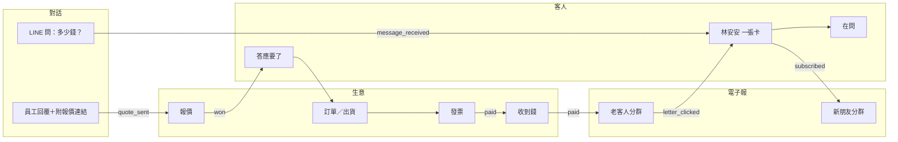

# 四個系統規劃：對話 × 電子報 × 客人 × 生意

狀態：規劃稿，第 0 節的決策待確認後才動程式  
範圍：Open Chat（對話收件匣）、電子報、CRM、ERP 四個系統，以及把它們串成**同一個客人、同一條生意**的資料迴圈  
與其他文件的關係：邊界與授權仍以 [ARCHITECTURE.md](ARCHITECTURE.md) 為準；本文件只把這四個系統展開到「員工看到什麼、資料怎麼流、怎麼從示範變真的」

---

## 0. 待確認的決策

這六題決定後面所有程式。每題都有建議，但沒有確認前不寫進 `web/`。

| # | 問題 | 選項 | 建議 | 理由 |
| --- | --- | --- | --- | --- |
| D1 | 「Open Chat」指什麼？ | A. 對話收件匣：LINE 官方帳號、IG／FB 私訊、官網聊天，同一個畫面回<br/>B. LINE 社群（OpenChat）群組 | **A** | LINE 社群沒有官方 API，無法合法串接或讀取；只能人工經營，再用短網址把人帶進 A |
| D2 | 對話用什麼引擎？ | A. Chatwoot 收人工對話 + OpenReply 只做留言關鍵字私訊<br/>B. 只用 Chatwoot<br/>C. 自己寫 | **A** | Chatwoot 有 LINE、IG、FB、官網小工具通道，但沒有「IG 留言命中關鍵字自動私訊」；OpenReply 補這塊。自己寫要處理 Meta 審核與視窗規則，不划算 |
| D3 | 電子報用什麼引擎？ | A. Mautic + Postal（序列、計分、分群都有）<br/>B. Listmonk + Postal（只發電子報，很輕）<br/>C. 兩個都上 | **A** | 架構已定 Mautic 管行銷同意與分群；再加 Listmonk 就是第二份同意名單，退訂會不同步。若你判斷客人只要「每月一封」、不要自動序列，改選 B，程式介面不變 |
| D4 | 客人名單畫面用誰？ | A. DropOut 產品殼自己的看板，資料存 ERPNext<br/>B. 上 Frappe CRM 當前台 | **A** | 產品殼已經有客人看板與現場語言；再上 Frappe CRM 等於員工要學兩套畫面 |
| D5 | LINE 要不要拿來發「電子報」？ | A. 第一期不做 LINE 群發，只做一對一回覆<br/>B. 第一期就做 LINE 群發 | **A** | LINE 主動推播會吃方案訊息額度（回覆用 reply token 不算）；群發要先有分群與同意，等電子報分群跑通再加 |
| D6 | 同一個人在不同通道，怎麼認成一個？ | A. 只有 email 或手機**驗證過一致**才自動合併，其餘由員工按「是同一個人」<br/>B. 姓名相同就合併 | **A** | LINE userId、IG 帳號 ID 都只在各自平台有效，姓名會撞；合併錯了比沒合併嚴重（會把別人的帳單寄給他） |

產品殼命名同步調整（依 D1、D3）：

| 現在的模組 id | 現在的名稱 | 改成 | 員工看到 |
| --- | --- | --- | --- |
| `reply` | 社群留言 | `chat` | **對話**：LINE、IG、FB、官網，在同一排回；留言關鍵字是其中一個分頁 |
| `funnel` | 把人帶來 | `letter` | **電子報**：寫一封、挑哪些人、看誰打開 |
| `crm` | 跟人 | 不變 | **客人** |
| `sales` `stock` `purchase` `finance` | 生意／倉庫／進貨／收錢 | 不變 | 不變 |

改 id 會影響已經存在的 `dropout_shop` cookie；讀取時把舊 id 對應到新 id，不讓已經設定過的瀏覽器壞掉。

---

## 1. 一個人走完四個系統

用示範演員「林安安」說明迴圈。每一步都只產生**一個事件**，下一個系統只看事件，不互相直接改資料。



| 步驟 | 員工做了什麼 | 事件 | 誰收到、做什麼 |
| --- | --- | --- | --- |
| 1 | 什麼都沒做；安安在 LINE 問價 | `message_received` | 客人：找不到人就建「在問」卡；今天：出現「安安在等你回」 |
| 2 | 在對話裡按「回她＋附報價」 | `quote_sent` | 生意：建報價單；客人：卡片顯示報價金額 |
| 3 | 安安回「好」，員工按「她答應了」 | `won` | 生意：報價轉訂單；電子報：停止「新朋友」促銷信 |
| 4 | 倉庫按「出貨」 | `fulfilled` | 對話：可選擇在 LINE 告訴她已出貨（回覆視窗內才送） |
| 5 | 會計開發票 | `invoiced` | 電子發票加值中心開立；客人卡片顯示發票號碼 |
| 6 | 錢進來 | `paid` | 電子報：移進「老客人」分群；今天：從催收清單拿掉 |
| 7 | 下個月安安點了電子報裡的新品 | `letter_clicked` | 客人：卡片冒出「她又在看」；今天：排進業務的下一件事 |

**員工全程只碰三個按鈕：回她、她答應了、出貨。** 其他都是事件自動跑。

---

## 2. 共用資料契約

四個系統只共享這四種東西。其他欄位各系統自己管。

### 2.1 客人（Party）——權威在 ERPNext

| 欄位 | 說明 |
| --- | --- |
| `party_id` | ERPNext Customer 或 Lead 的 name；全系統唯一對照鍵 |
| `display_name` | 員工看到的名字；**不當對照鍵** |
| `email` | 正規化小寫；`+tag` 處理方式在第一個示範租戶定案 |
| `phone_e164` | 例：`+886912345678` |
| `tax_id` | 統一編號，8 碼，伺服端驗證檢查碼 |
| `stage` | 依產業包的流程階段（在問／答應要了／已付款…） |
| `owner` | 負責的員工 |

### 2.2 通道身分（Identity）——權威在 ERPNext 自訂 DocType

一個客人可以有很多身分。合併規則見 D6。

| 欄位 | 範例 | 說明 |
| --- | --- | --- |
| `party_id` | `CUST-0042` | 指回客人 |
| `channel` | `line` `ig` `fb` `web_chat` `email` | |
| `external_id` | LINE userId、IG 帳號範圍 ID、email | 只在該平台、該官方帳號下有效 |
| `verified` | `true` / `false` | email 點過確認信、手機收過驗證碼才算 |
| `first_seen_at` | ISO 時間 | |

合併：

1. 新訊息進來，用 (`channel`, `external_id`) 找身分 → 找到就掛同一個客人
2. 找不到 → 建「在問」潛在客人 + 一筆身分
3. 之後若同一個 email／手機**都已驗證**出現在兩個客人 → 自動合併，留合併紀錄
4. 只有姓名像、或未驗證 → 客人卡片顯示「可能是同一個人」，員工按一下才合併
5. 合併可以撤銷（保留原 `party_id` 對照）

### 2.3 同意（Consent）——行銷同意權威在 Mautic，交易通知同意在 ERPNext

| 類型 | 例子 | 沒同意時 |
| --- | --- | --- |
| 交易通知 | 出貨、發票、付款提醒 | 只能在客人主動來問的對話視窗內回 |
| 行銷 | 電子報、促銷、LINE 群發 | 一律不寄、不推 |

每筆同意存：通道、時間、來源頁面或對話、文案版本。退訂從任何通道進來，**同一個事件**關掉所有行銷通道。

### 2.4 事件（Event）——寫進 ERPNext 自訂 DocType，由膠水寫入

| 事件 | 誰發 | 必帶 |
| --- | --- | --- |
| `message_received` | 對話 | `party_id` 或 (`channel`, `external_id`)、對話連結 |
| `lead_captured` | 官網表單、留言關鍵字 | UTM、同意文案版本 |
| `subscribed` / `unsubscribed` | 電子報、對話 | 通道、來源 |
| `quote_sent` | 生意 | 報價單號、金額 |
| `won` / `lost` | 客人 | 原因（lost 必填） |
| `fulfilled` | 生意 | 出貨或交付單號 |
| `invoiced` | 生意 | 發票號碼 |
| `paid` | 生意 | 收款單號、金額 |
| `letter_opened` / `letter_clicked` | 電子報 | 信件 id、連結 |

每個事件都有 `idempotency_key`（來源系統 id + 事件名），重送不會重複建單。

---

## 3. 四個系統各自長什麼樣

### 3.1 對話（Open Chat）

**員工看到：** 一排對話，最久沒回的在最上面。點開右邊就是這個客人的卡片（在哪一階段、買過什麼、欠多少）。輸入框下面只有三個常用動作：**回她**、**附報價**、**標成同一個人**。

| 項目 | 規劃 |
| --- | --- |
| 引擎 | Chatwoot（LINE 官方帳號、FB Messenger、IG 私訊、官網小工具）；OpenReply（IG／FB 留言關鍵字 → 私訊） |
| 分工 | 留言歸 OpenReply；私訊與聊天歸 Chatwoot。同一則對話只有一個系統負責送出，避免兩邊同時回 |
| 寫回 | 每則新對話 → `message_received`；留言命中 → `lead_captured` |
| 今天 | 「誰在等你回」依等待時間排序；超過公司設定的分鐘數升到第一件事 |
| 不做 | AI 自動回覆、LINE 社群群組串接、自己寫 Meta／LINE 連線 |
| 平台規則 | Meta：客人最後一則訊息後 24 小時內可自由回；超過要用人工客服標籤（最長 7 天，需權限）。LINE：用回覆 token 回不吃額度，主動推播吃方案額度 |
| 失敗時 | Chatwoot 掛了：訊息仍留在 LINE／Meta 後台，畫面顯示「對話暫時收不到，請到 LINE 官方帳號後台看」，恢復後補抓。寫回 ERPNext 失敗：進死信重試，對話本身不受影響 |

### 3.2 電子報

**員工看到：** 三步。**寫一封**（標題、內文、一個按鈕）→ **挑誰收**（新朋友、老客人、某個標籤）→ **看結果**（誰打開、誰點、誰因此下單）。不顯示活動畫布，除非管理員打開進階。

| 項目 | 規劃 |
| --- | --- |
| 引擎 | Mautic（分群、序列、同意、追蹤）+ Postal（實際寄送、退信） |
| 名單來源 | 只從 ERPNext 客人同步進 Mautic，且必須有行銷同意；不讓員工匯入來路不明的 Excel 直接寄 |
| 清庫 | 新 email 先過 Reacher；無效不寄、拋棄式不寄、有風險降頻 |
| 分群 | 由事件決定：`paid` → 老客人；`won` 前 → 新朋友；`unsubscribed` → 全部移除 |
| 寫回 | `letter_opened`、`letter_clicked` 回到客人卡片；`unsubscribed` 關掉所有行銷通道 |
| 寄件網域 | 每家公司自己的網域，SPF、DKIM、DMARC 檢查通過才允許寄；新網域依量逐步加量 |
| 不做 | 自己寫編輯器、自己寫寄信、無同意名單群發 |
| 失敗時 | Postal 硬退 → 該 email 停寄並回寫客人卡片；Mautic 掛了 → 排程信延後，畫面顯示「這封還沒寄出」，不顯示假的寄出數 |

### 3.3 客人（CRM）

**員工看到：** 依產業包的階段排成幾欄（例：在問 → 答應要了 → 已付款）。每張卡片只有名字、最後一次聯絡是哪個通道多久前、下一步一個按鈕。點開是客人 360：對話紀錄、報價、訂單、發票、電子報互動，依時間排一條。

| 項目 | 規劃 |
| --- | --- |
| 權威 | ERPNext Lead／Customer／Opportunity + 2.2 的身分表 |
| 畫面 | 產品殼 `/workspace/crm`（D4），不另上 Frappe CRM |
| 階段 | 產業包給預設，公司可改名、增減、跳過；事件名不變 |
| 派案 | 新的「在問」依公司規則派給人（輪流或指定通道給指定人）；第一期只做輪流與指定 |
| 今天 | 「答應了但還沒出貨」「報價三天沒回」進待辦 |
| 不做 | 第二套 CRM、銷售預測、AI 評分 |
| 失敗時 | ERPNext 掛了：看板唯讀並標示最後同步時間；新的對話先記在膠水佇列，恢復後依 `idempotency_key` 補建 |

### 3.4 生意（ERP）

**員工看到：** 現有的「同一張單往下走」：報價 → 訂單 → 出貨或交付 → 發票 → 收錢。採購、倉庫、收錢對帳維持現有頁面，只是資料改讀 ERPNext。

| 項目 | 規劃 |
| --- | --- |
| 權威 | ERPNext：Quotation、Sales Order、Delivery Note、Sales Invoice、Payment Entry、Purchase Order、Stock Entry |
| 稅 | 營業稅 5% 在 ERPNext 稅表；統一編號存客人主檔 |
| 電子發票 | 透過加值服務中心的 API 開立、作廢、折讓；不自己連財政部。供應商選定前，畫面只顯示「待上傳」 |
| 金流 | 綠界／藍新等金流 webhook → 膠水 → ERPNext 收款；對不上金額的進人工對帳清單，不自動沖帳 |
| 寫回 | `quote_sent`、`fulfilled`、`invoiced`、`paid` |
| 不做 | 自己寫會計引擎、自己寫稅核、MRP、薪資 |
| 失敗時 | 加值中心失敗：發票停在「待上傳」並排進今天；金流 webhook 重送：依交易序號冪等；ERPNext 過帳失敗：單據不往下一步，顯示原因 |

---

## 4. 系統之間的同步（膠水：Activepieces）

所有跨系統動作只走這張表。新增一條要先加進這裡。

| # | 觸發 | 動作 | 冪等鍵 |
| --- | --- | --- | --- |
| G1 | Chatwoot 新對話 | 找或建客人與身分，寫 `message_received` | Chatwoot conversation id |
| G2 | OpenReply 命中留言 | 建潛在客人，寫 `lead_captured` | Meta comment id |
| G3 | 官網表單 | Reacher 檢查 → 建潛在客人；有勾行銷同意才進 Mautic | 表單提交 id |
| G4 | ERPNext 客人有行銷同意 | 同步到 Mautic 聯絡人 | `party_id` |
| G5 | ERPNext `won` / `paid` | 更新 Mautic 分群與標籤 | 單號 + 事件 |
| G6 | Mautic 退訂 | ERPNext 關掉所有行銷同意；Chatwoot 標記勿推播 | Mautic 聯絡人 id + 時間 |
| G7 | Mautic 開信／點擊 | 寫回客人時間軸 | Mautic 事件 id |
| G8 | Postal 硬退 | ERPNext 與 Mautic 標記 email 無效 | Postal message id |
| G9 | 金流 webhook | 建 ERPNext 收款（金額相符才自動） | 金流交易序號 |
| G10 | ERPNext 開發票 | 呼叫加值中心開立，回寫發票號碼 | Sales Invoice name |

失敗一律：重試三次（間隔遞增）→ 進死信清單 → 今天出現「有 N 筆資料沒同步」給管理員，不默默吞掉。

---

## 5. 安全

| 進來的東西 | 驗證 |
| --- | --- |
| LINE webhook | `x-line-signature`：用 channel secret 對原始 body 做 HMAC-SHA256 比對 |
| Meta webhook（OpenReply、Chatwoot） | `X-Hub-Signature-256`：用 App Secret 驗 |
| Mautic webhook | 用 webhook secret 驗簽名標頭（依部署版本文件確認標頭名稱） |
| Postal webhook | 用 Postal 公鑰驗簽名（依部署版本文件確認） |
| ERPNext webhook | Frappe Webhook secret 簽名 |
| Chatwoot webhook | 若部署版本沒有簽名，改用私密路徑 token + 來源 IP 限制 |
| 金流 webhook | 依金流商規格的檢查碼，且金額、訂單號要跟 ERPNext 比對 |

其他規則：

- 所有 webhook 先驗簽、再驗時間戳（拒絕過舊請求）、再看冪等鍵
- 對話內容、電子報內文顯示在產品殼一律當純文字或經過消毒的 HTML，不直接插入原始 HTML
- 電子報內文的連結只允許 `https:`，擋 `javascript:` 等協定
- 統一編號、email、手機在伺服端驗格式，前端驗證只是方便
- 權限：會計看不到行銷原始名單匯出；客服看不到總帳；外包行銷只進電子報
- 祕密（channel secret、App Secret、API token）只放環境變數，不進 git、不送到瀏覽器

---

## 6. 產品殼怎麼從示範變真的

現在 `web/lib/erp.ts`、`web/lib/reply.ts` 都是瀏覽器裡的示範資料。接真系統時不要重寫畫面，只在中間加一層**資料來源**：

```
web/lib/sources/
  types.ts        ← 四個系統共用的 Party / Identity / Event 型別
  demo/           ← 現在的示範資料搬進來
  live/           ← 呼叫 ERPNext、Chatwoot、Mautic 的伺服端程式
  index.ts        ← 依環境變數選 demo 或 live
```

規則：

1. 畫面只呼叫 `sources`，不知道背後是示範還是真的
2. `live` 只在伺服端執行（Server Component／Route Handler），token 不會到瀏覽器
3. 每個系統各自切換：可以先接 ERPNext、對話還是示範
4. 只要有任何一塊是示範，畫面上那一塊就標「示範資料」，不可假裝已經送出或已經過帳
5. `live` 呼叫失敗時回傳明確的錯誤狀態，畫面顯示「暫時讀不到 ERPNext」，不退回示範資料混著顯示

---

## 7. 分期（依依賴排序）

每期結束的驗收都是：**示範公司用設定、不改核心程式，就能跑完自己的一筆生意。**

| 期 | 做什麼 | 依賴 | 驗收 |
| --- | --- | --- | --- |
| 7.1 示範迴圈 | 產品殼：`chat`、`letter` 模組改名與頁面；共用型別；林安安從對話走到老客人分群，全在示範資料 | 第 0 節確認 | 不接任何後端，一個瀏覽器裡走完第 1 節七步，每步都標示範 |
| 7.2 資料來源層 | `web/lib/sources` 拆 demo／live；現有頁面改讀 `sources` | 7.1 | 換環境變數切 demo，畫面行為不變 |
| 7.3 ERPNext 真的 | 一個 ERPNext site：客人、身分 DocType、事件 DocType、報價到收款；殼的客人與生意讀它 | 7.2、Keycloak | 在殼裡建報價，ERPNext 看得到同一張單；ERPNext 關掉時殼顯示讀不到而不是壞掉 |
| 7.4 對話真的 | Chatwoot 接官網小工具與 LINE 官方帳號；G1；殼的對話頁讀 Chatwoot | 7.3、LINE 官方帳號與 channel secret | 用手機在 LINE 問一句，殼裡出現在客人卡片上 |
| 7.5 電子報真的 | Mautic + Postal + Reacher；G3–G8；寄件網域 DNS | 7.3、公司網域 | 寄一封給「老客人」，點擊回到客人時間軸；退訂後 LINE 也不再推 |
| 7.6 社群與金流發票 | OpenReply（Meta App Review 通過後）、G2；金流 G9；電子發票 G10 | 7.4、Meta 審核、金流與加值中心合約 | IG 留言「價格」→ 私訊 → 客人卡片 → 報價 → 付款 → 發票號碼回到卡片 |

7.1 與 7.2 只動產品殼，不需要任何外部帳號，可以先做。7.3 之後每一期都需要外部帳號或審核，列在第 8 節。

---

## 8. 外部條件與風險

| 項目 | 需要什麼 | 風險 | 緩解 |
| --- | --- | --- | --- |
| LINE 官方帳號 | Messaging API channel、channel secret／token | 主動推播超過方案額度要付費 | D5：第一期只回覆不群發 |
| Meta（IG／FB） | 粉專、IG 專業帳號、App Review 權限 | 審核時間不可控；24 小時視窗 | 對話與留言功能在審核前只開示範；超過視窗的回覆在畫面提醒 |
| 寄信 | 公司網域 DNS（SPF、DKIM、DMARC）、乾淨的出口 IP | 新 IP 被當垃圾信 | 逐步加量；硬退立即停寄 |
| 電子發票 | 加值服務中心合約與 API 金鑰 | 各家 API 不同 | 適配器只定義開立／作廢／折讓三個動作，換供應商只換適配器 |
| 金流 | 金流商合約 | 對帳不符 | 金額不符不自動沖帳 |
| 個資法 | 同意紀錄、查詢與刪除流程 | 合併錯誤導致資料外洩 | D6 保守合併；合併可撤銷；刪除請求一次刪四個系統 |
| 授權 | ERPNext／Mautic GPL-3、Chatwoot MIT（含企業版功能目錄）、OpenReply MIT | 誤用 Chatwoot 企業版功能 | 只部署社群版功能 |
