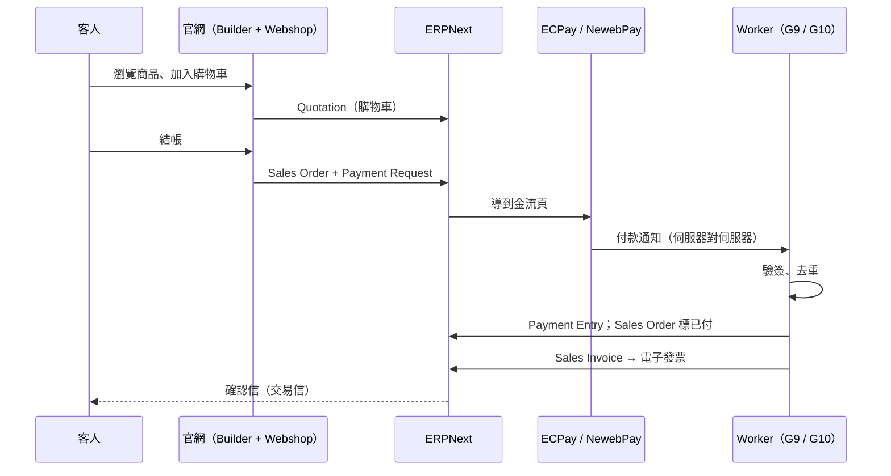

# 官網商店與導入工具

> 原則同 `ARCHITECTURE.md` 0.4：走上游預設、支援最久的路；不改上游原始碼；差異只放在設定、自訂欄位、Frappe 自訂 app、轉接器。

---

## 1. 官網：商品目錄與結帳

### 1.1 決定

| 層 | 用什麼 | 為什麼 |
| --- | --- | --- |
| 頁面、落地頁 | Frappe Builder | 與 ERPNext 同站、同帳號 |
| 商品目錄、購物車、結帳 | Frappe Webshop（v15 的官方電商 app，GPL-3） | 商品、價格表、庫存、訂單直接是 ERPNext 的 Item／Price List／Bin／Sales Order，不用同步 |
| 金流 | Frappe Payments（Payment Request／Payment Gateway） + 我們的台灣金流 app `dropout_pay_tw` | ECPay、NewebPay 上游沒有；用 Payments 的標準擴充點加，不改上游 |
| 金流回呼 | Cloudflare Worker（G9）→ ERPNext API | 驗簽、去重（idempotency_key）、重試在膠水層，ERPNext 只收乾淨事件 |
| 電子發票 | G10（paid-tw/einvoice） | 付款成功 → Sales Invoice → 開立 |

不接 Shopify、WooCommerce、Medusa：會多一份商品與訂單主檔，要雙向同步，這是治標。

### 1.2 一筆訂單怎麼走

### 1.3 已知限制（照實寫）

- **v15 訪客結帳**：Webshop 在 v15 結帳要先登入成為入口網站使用者。第一版用「Email 一次性登入」把步驟降到一步；等上游修好訪客結帳再打開，不自己改 Webshop。
- **Webshop 改版**：上游正把商店頁改成 Builder 為底。我們的商品頁版型放在 Builder，資料只讀 ERPNext 標準欄位，改版時只換版型。
- **台灣金流 app 要自己寫**：只實作 Payments 的 gateway 介面（建立付款、回呼、退款查詢），邏輯越少越好；ECPay 先、NewebPay 後。
- **規模**：Webshop 適合中小商品數（數百到數千品項）。超過時再評估，不在第一版處理。

### 1.4 三家示範公司怎麼用

| 示範公司 | 官網要做的事 |
| --- | --- |
| 製造業 | 商品目錄 + 詢價（Quotation），不一定線上付款 |
| 顧問業 | 服務方案頁 + 預約／諮詢表單 → 客人卡片；方案可線上付訂金 |
| 教育服務業 | 課程（Item）+ 期班（變體或專案）+ 線上報名付款 |

---

## 2. 導入工具組

目標：**一家新公司從簽約到跑完第一筆真實生意，全部用工具與設定完成，不改核心程式。**

### 2.1 組成

| 工具 | 是什麼 | 上游依據 |
| --- | --- | --- |
| `dropout_core` | Frappe 自訂 app：自訂欄位（統編等）、Identity／Consent／Event DocType、角色、工作流、工作區、台灣列印格式、信件範本 | `hooks.py` fixtures；`install-app`、`migrate` 時自動套用 |
| 產業包 | `dropout_pack_make`、`dropout_pack_service`、`dropout_pack_edu`，各自獨立 app | 要開就裝、要關就移除，互不影響 |
| `dropout_pay_tw` | 台灣金流 gateway（見 1.1） | Frappe Payments 擴充點 |
| 開站指令 | `bench new-site` → `install-app erpnext payments webshop builder dropout_core dropout_pack_x` → 設定精靈；同時開 Chatwoot 帳號、Vexa 金鑰 | 全是官方指令；輸入取自殼的 ShopProfile（場景、規模、模組） |
| 搬家範本 | Data Import 範本 + 欄位對照（鼎新 A1、ECOUNT、Excel 匯出） | Frappe Data Import（新增／更新）；大量用 `bench data-import` |
| 導入引導 | Module Onboarding 步驟（fixtures）；未完成的步驟出現在殼的「今天」 | Frappe Module Onboarding |
| 檢查報表 | 統編檢查碼、重複客人、缺價格、負庫存、科目沒對上 | Script Report，放在 `dropout_core` |
| 導入專案範本 | 我們自己的 ERPNext 裡的 Project Template，追每家客戶的導入進度 | ERPNext Projects |
| 教學（選配） | Frappe Learning 課程 | 同生態 |

### 2.2 搬家順序

順序固定，前一步沒過檢查不做下一步：

1. 公司與科目表（Chart of Accounts Importer）
2. 客人、供應商（含統編、聯絡人、地址）
3. 商品、價格表
4. 期初庫存（Stock Reconciliation）
5. 期初應收應付（Opening Invoice Creation Tool）
6. 未結訂單（Sales Order／Purchase Order）
7. 通道身分：LINE／IG／FB 的 external_id 綁到客人（Identity，`verified` 預設否）
8. 電子報名單：只匯入有同意紀錄的人（Consent）；沒有的寄確認信重新取得

### 2.3 導入的關卡

| 關卡 | 驗收 |
| --- | --- |
| 開站 | 指令跑完，ERPNext、Chatwoot、殼都能用同一個帳號登入 |
| 搬家 | 檢查報表全綠；期初試算表與舊系統一致 |
| 通道 | LINE 問一句，出現在客人卡片 |
| 官網 | 一筆線上訂單付款成功，發票開出 |
| 上線 | **第一筆真實生意**從詢問走到收款 |

### 2.4 不做

- 不寫自己的匯入器：一律 Data Import；欄位對照是範本與說明，不是程式。
- 不改設定精靈：它只跑一次，其餘設定走 fixtures。
- 不為單一客戶分支程式碼：差異放在產業包或站台設定。

### 2.5 實作現況（與上面規劃不同的地方）

工具在 `toolkit/`（`dropout-onboard` 指令，見 [toolkit/README.md](../toolkit/README.md)），Frappe app 在 `frappe-apps/`。已在本機 ERPNext v15 bench 上跑過開站、搬家與期初庫存。和規劃不同的地方：

| 規劃 | 實作 | 原因 |
| --- | --- | --- |
| Module Onboarding fixtures 當導入引導 | `dropout_core` 從資料推算導入進度（有沒有公司、客人、商品、期初、第一張單…），殼的「今天」與設定頁顯示 | 進度看資料本身，不會勾了但沒做；不依賴 Module Onboarding 的 UI |
| 大量用 `bench data-import` | 一律建 Data Import 文件再執行，失敗訊息整理後回給工具 | 與畫面上的匯入同一條路，留紀錄、可重跑 |
| 期初庫存走 Data Import | `provisioning.opening_stock` 直接建 Opening Stock 的 Stock Reconciliation，差異科目用公司的暫時開帳科目；同檔重跑會略過 | ERPNext 對 Stock Reconciliation 關閉匯入 |
| 產業包安裝時就套用 | 設定精靈還沒跑完時先延後，`setup_wizard_complete` 時套用全部已裝的包 | 精靈跑完前沒有「全部商品群組」等根資料 |
| 開站裝 Builder | 不裝 | 官網在殼與 Webshop；Builder 之後要再評估 |
| 「同一個帳號登入」 | ERPNext 當 OAuth2 提供者，殼用 PKCE 登入；Chatwoot 以 Platform API 單一登入，`link_chatwoot_user` 對應帳號 | 不另架 Keycloak 也能一次登入 |
| 開站、轉檔、匯入分開下指令 | 另加 `bootstrap <資料夾>`：一個資料夾放 `bootstrap.json` 與舊檔，一行跑完開站到期初應收應付；公司代碼、倉庫等從站台讀；依檔案內容記進度，重跑略過 | 快速導入；三家示範公司（`toolkit/examples/{make,service,edu}`）都用這一行開出來 |

---

## 3. 放在哪一期

| 期 | 加入 |
| --- | --- |
| 2 | `dropout_core` 第一版（fixtures）、開站指令、搬家範本與順序、檢查報表 |
| 4 | Webshop 商品目錄、詢價、登入結帳（先接 ERPNext 內建付款請求） |
| 5 | `dropout_pay_tw`（ECPay → NewebPay）、G9 回呼、G10 發票；三個產業包；導入引導進「今天」 |
