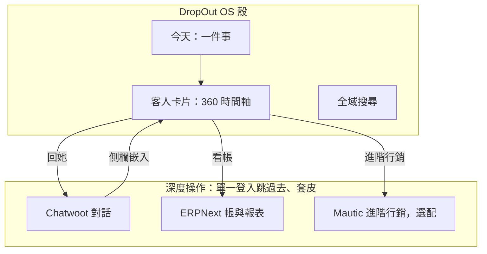
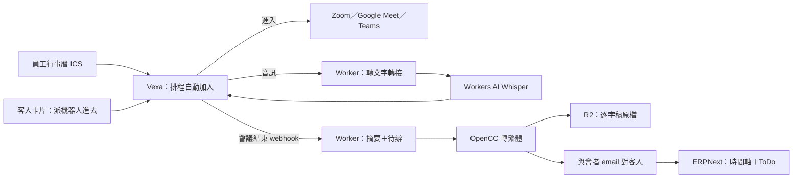
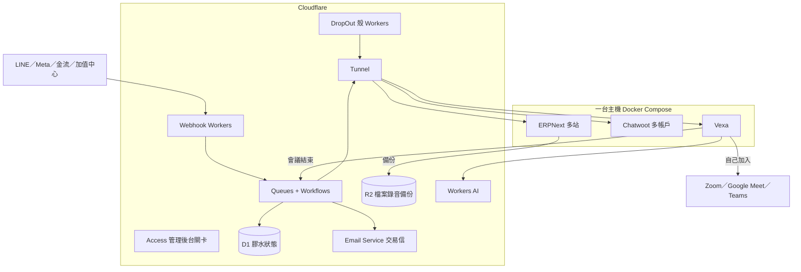

# 大整合：一次登入做完所有事

狀態：規劃稿，第 0 節待確認  
回答三個問題：

1. 現在的組合有沒有重複造輪子、有沒有更好的工具、有沒有更好的握法？
2. 加上開源會議紀錄機器人，要怎麼接進同一個客人？
3. 要實現這些還缺什麼？能不能全部用 Cloudflare？

與其他文件的關係：本文件修訂 [ARCHITECTURE.md](ARCHITECTURE.md) 的部署與膠水選擇、[FOUR-SYSTEMS-PLAN.md](FOUR-SYSTEMS-PLAN.md) 的 D3。確認後，兩份文件依本文件更新。

---

## 0. 待確認的決策

| # | 問題 | 建議 | 取代了什麼 |
| --- | --- | --- | --- |
| P1 | 產品殼要做多少畫面？ | **薄殼**：殼只做「今天、客人卡片、一鍵下一步、全域搜尋」；深度操作用單一登入跳進原系統（套 DropOut 皮） | 原本有往「殼重做每個系統畫面」走的趨勢 |
| P2 | 系統之間的同步用什麼？ | **Cloudflare Workers + Queues + Workflows** 寫固定的 G1–G10；Activepieces 延後到「客戶要自己拉自動化」時才上 | Activepieces 當第一期膠水 |
| P3 | 電子報第一期用什麼？ | **ERPNext 內建電子報與 Email Campaign**，寄送走 Amazon SES 或同級的外部寄信服務；客戶需要計分、視覺化序列時才為該客戶加 Mautic | 每家公司一套 Mautic + Postal |
| P4 | 員工登入用什麼？ | **ERPNext 當登入中心**（Frappe 可當 OAuth2／OpenID Connect 提供者），Cloudflare Access 只擋管理後台；Keycloak 延後 | 第一期就上 Keycloak |
| P5 | 會議紀錄怎麼做？ | **Vexa 機器人**：接員工行事曆，時間到自己進 Zoom／Google Meet／Teams；轉文字走 Workers AI。Cloudflare RealtimeKit 只在要自己發會議連結時選配 | 新增 |
| P6 | 部署在哪？ | **Cloudflare 當前門與膠水，一台主機跑重系統**，兩邊用 Cloudflare Tunnel 連；不硬塞全部上 Cloudflare | 原本未定 |
| P7 | 清庫第一期怎麼做？ | **雙重確認訂閱 + 退信自動停寄**；Reacher 延後 | 第一期就上 Reacher |
| P8 | IG／FB 留言轉私訊第一期用什麼？ | **Meta Business Suite 內建「留言轉私訊」**；客人回覆後的對話由 Chatwoot 接手。需要每篇貼文不同規則、公開回覆＋私訊、留言當下就建潛在客人時，才為該客戶加 OpenReply | OpenReply 第一期必裝 |
| P9 | 主機怎麼管？ | **Coolify**（Apache-2.0）管 Docker 服務、TLS、資料庫備份到 R2；ERPNext 另用內建 S3 備份 | 手寫 Docker Compose |
| P10 | 電子發票怎麼接？ | **[paid-tw/einvoice](https://github.com/paid-tw/einvoice)**（MIT）在 Worker 裡呼叫，一套介面接綠界、藍新、光貿等；換加值中心只換設定 | 自己寫每家加值中心的適配器 |

這十題確認後，第一期要自己架的系統從 11 套降到 3 套（ERPNext、Chatwoot、Vexa），其餘用 Cloudflare、外部服務或延後。

---

## 1. 重複造輪子檢查

### 1.1 有在重做別人已經做好的東西

| 位置 | 問題 | 改法 |
| --- | --- | --- |
| 殼的對話頁 | 若在殼裡重做收件匣（即時訊息、貼圖、附件、快捷回覆、指派），等於重寫 Chatwoot | 殼只顯示「誰在等你回」與客人卡片；按「回她」打開 Chatwoot 的那則對話。另外用 Chatwoot 的 Dashboard Apps 把**我們的客人卡片**嵌進 Chatwoot 側欄，兩邊看到同一個人 |
| 殼的電子報頁 | 若在殼裡做信件編輯器、分群編輯器，等於重寫 Mautic | 殼只做最常見的一條：寫一封、挑一個分群、看結果；進階一律開原系統 |
| 殼的 ERP 頁 | 簡化的「同一張單往下走」**值得自己做**，因為 ERPNext 原生畫面正是我們要藏的複雜度 | 保留，但只呼叫 ERPNext API，不在殼裡存任何帳 |
| 會計、稅表、報表 | 殼裡不要重做 | 直接開 ERPNext 對應頁面 |
| G1–G10 同步 | 用 Activepieces 畫 10 條固定流程，還要多養一套 Node + Postgres + Redis | 固定流程本來就是我們的程式；用 Cloudflare Workflows 寫，重試、排程、死信都是平台內建 |

### 1.2 同一件事有兩套系統

| 重疊 | 現在 | 建議 |
| --- | --- | --- |
| 登入 | Keycloak + ERPNext 各有帳號 | ERPNext 當唯一帳號來源（P4）；之後真的要接客戶自己的 Google Workspace／Microsoft 365 時，再評估 Keycloak 或 Cloudflare Access |
| 行銷名單與同意 | Mautic 與 ERPNext 各一份 | 第一期只有 ERPNext 一份（P3），退訂不會不同步 |
| 寄信 | Postal 與 Mautic 內建、之後還有交易信 | 交易信（出貨、發票、密碼）走 Cloudflare Email Service；電子報走外部寄信服務。不自架 Postal |
| Meta 連線 | OpenReply 與 Chatwoot 都接同一個粉專 | 第一期只有 Chatwoot 接 Meta，留言轉私訊用 Meta 內建（P8）；之後加 OpenReply 時，留言歸 OpenReply、私訊歸 Chatwoot，並驗證兩個 App 同時訂閱同一粉專的訊息歸屬 |
| 錄音轉文字 | Vexa 自帶 Whisper 要 GPU | 改接 Workers AI（見第 2 節），不買 GPU |

### 1.3 有更好的工具嗎

| 需求 | 原選擇 | 更好的選擇 | 為什麼 |
| --- | --- | --- | --- |
| 電子報（中小企業） | Mautic | ERPNext 內建電子報 → 需要時加 Mautic | Mautic 是一家公司一套，一百家客戶就是一百套 PHP + MySQL；ERPNext 一台主機可以開很多站 |
| 自動化膠水 | Activepieces | Cloudflare Workflows | 我們的流程是固定的，不需要拖拉畫布 |
| 檔案與錄音 | MinIO | Cloudflare R2 | 不用自己養物件儲存；ERPNext 附件與備份可寫 S3 相容儲存 |
| 交易信 | Postal | Cloudflare Email Service | 不用養 IP 信譽；但它只允許交易信 |
| 會議逐字稿 | 自架 GPU Whisper | Workers AI（Whisper Large v3 Turbo） | 依音訊分鐘計費，不閒置 |
| 對外網路 | 主機開公開埠 | Cloudflare Tunnel | 主機不開任何對外埠，WAF 與 TLS 在 Cloudflare |

### 1.4 沒有更好、維持原案的

| 系統 | 理由 |
| --- | --- |
| ERPNext | 台灣中小企業要的報價到收款、庫存、帳齡在社群版都有；換 Odoo 會撞到企業版的功能牆 |
| Chatwoot | 有 LINE、IG、FB、官網小工具通道，同一套就能服務多家公司（多帳戶） |
| OpenReply（選配） | 需要比 Meta 內建更細的留言規則時，沒有更成熟的開源替代 |
| Shlink | 仍是短網址最省事的選擇；但排到電子報跑通之後 |

### 1.5 更好的握法：殼只握三樣東西

員工每天的路：打開「今天」→ 點一件事 → 看到這個客人的卡片 → 按一個按鈕。按鈕如果需要完整工具（回訊息、對帳），就在同一個登入裡打開那個工具的那一頁。**殼不跟原系統比功能多，只負責「下一件事是什麼、這個人是誰」。**

---

## 2. 會議紀錄機器人：自己進 Zoom／Google Meet

目標：員工不用做任何事。行事曆上有會，時間到機器人自己進 Zoom、Google Meet 或 Teams，會後把摘要和待辦放回那個客人的卡片。

### 2.1 選哪一套

| 專案 | 授權 | 自己進會議 | 平台 | 決定 |
| --- | --- | --- | --- | --- |
| [Vexa](https://github.com/vexa-ai/vexa) | Apache-2.0 | ✅ 接行事曆（ICS）後依排程自動加入 | Google Meet、Zoom、Teams 為正式支援；Jitsi 尚在驗證 | **採用** |
| [MeetingBot](https://github.com/meetingbot/meetingbot) | LGPL-3.0 | 透過 API 派送 | Meet、Teams、Zoom | 候選：只錄音，部署綁 AWS Terraform |
| [Attendee](https://github.com/attendee-labs/attendee) | Elastic License 2.0 | ✅ 有行事曆整合 | Meet、Teams、Zoom | **不用**：授權不允許代管給第三方，跟我們賣給其他公司衝突 |
| [Meetily](https://github.com/Zackriya-Solutions/meeting-minutes) | MIT | ❌ 不進會議，在筆電本機錄 | — | 只給實體會議用 |
| [Cloudflare RealtimeKit](https://developers.cloudflare.com/realtime/realtimekit/) | 託管服務 | ❌ 它是會議室本身，不是機器人 | 自家會議室 | 選配：要自己發會議連結時才用 |

Vexa 的加入方式是開一個瀏覽器進會議，跟人用網頁加入一樣：

- **Google Meet**：預設以訪客身分敲門，主持人按「允許」才進。可改成「登入模式」：機器人用一個公司專用的 Google 帳號登入，同公司的會議可以直接進，限定組織內的會議也進得去
- **Zoom**：用 Zoom 網頁版加入，**不需要申請 Zoom App**；有等候室時要主持人放行
- **Teams**：以訪客加入，依對方組織設定可能要放行

### 2.2 員工看到什麼

1. **第一次設定**：在個人設定貼上自己的行事曆 ICS 網址（Google 日曆「私人網址」或 Outlook 發佈的行事曆），選規則：
   - 有外部客人的會都進（預設）
   - 全部都進
   - 只進標題有「#記錄」的會
2. **之後什麼都不用做**：「今天」會列出等一下機器人會進的會，每一場旁邊有一個**這場不要記**
3. 時間到，機器人以「DropOut 會議紀錄」名字加入，進場後在會議聊天室貼一句「本場由 DropOut 記錄，若不同意請告知，我會離開」
4. 主持人沒放行：五分鐘後機器人放棄，「今天」顯示「這場沒進去：等候室沒人放行」
5. 會議結束：用與會者的 email 對到客人，卡片時間軸多一筆**摘要、決定事項、待辦**
6. 待辦變成 ERPNext 的 ToDo，指派給負責人，出現在他的「今天」
7. 摘要提到報價或數量時，卡片上出現「要不要開報價」按鈕；**不自動開單**

臨時會議（沒排在行事曆上）：在客人卡片按**派機器人進去**，貼上會議連結即可。

### 2.3 資料流

- 對到客人的方式：與會者 email 對四系統規劃 2.2 節的通道身分表；對不到的外部 email 建「可能是新客人」，讓負責人確認，不自動建客人
- 新事件：`meeting_recorded`（`party_id`、會議時間、平台、逐字稿 R2 位置）、`meeting_summarized`（摘要與待辦）
- Vexa 的轉文字端點指向我們的 Worker，由 Worker 轉成 Workers AI 呼叫，不需要 GPU。這是約百行的轉接層，不是自研轉文字
- Whisper 的中文輸出可能是簡體，存檔前一律用 OpenCC（Apache-2.0）轉成台灣繁體
- Vexa 每場會議開一個瀏覽器容器；同時段要進幾場會，主機就要撐幾個容器

### 2.4 規則與風險

| 項目 | 規則 |
| --- | --- |
| 告知與同意 | 機器人名稱一定要看得出是記錄機器人，進場就宣告；客人卡片記「已告知錄音」。有人要求就立刻離開 |
| 誰的行事曆 | 只有員工自己貼的 ICS；不掃整個公司的行事曆 |
| 保存 | 逐字稿原檔與錄音依公司設定天數自動刪除；摘要跟著客人主檔 |
| Google 登入模式 | 一個 Google 帳號同時只能撐一個機器人（Vexa 文件明講，多個容器共用同一組登入會有帳號風險）。同時段要進 N 場，就要 N 個專用帳號 |
| Zoom 平台政策 | Zoom 從 2026 年 3 月起要求 Meeting SDK 應用程式加入外部會議時必須掛在某個使用者名下（OBF token）。Vexa 現在走的是網頁版，不是 SDK；若 Zoom 之後也收緊網頁版的自動加入，合規的替代是 Zoom 的 RTMS 或 SDK + OBF，兩者都需要 Zoom App 審核，而且授權的使用者必須人在會議裡。正式上線前要再確認一次 Zoom 的條款 |
| 主持人不放行 | 機器人無法自己繞過等候室；這是平台設計，不是錯誤 |
| 台語、口音 | Whisper 對台語效果差；畫面上標示「逐字稿僅供參考」，摘要讓負責人確認後才進時間軸 |
| 摘要品質 | 繁體中文摘要要先用真實會議錄音挑模型，沒測過之前不承諾品質 |

---

## 3. 能不能全部用 Cloudflare？

**不能全部，但可以讓 Cloudflare 承擔七成：前門、登入關卡、膠水、檔案、交易信、AI、自家會議室。** 有狀態的大系統放一台主機，經 Cloudflare Tunnel 接進來。

### 3.1 逐項判斷

| 元件 | 放 Cloudflare？ | 用什麼 | 理由 |
| --- | --- | --- | --- |
| DropOut 產品殼（Next.js） | ✅ | Workers（OpenNext Cloudflare adapter） | 搬遷前要先驗證 Next.js 16 能在 adapter 上 build；現在部署在 Vercel |
| DNS、TLS、WAF、防機器人 | ✅ | Cloudflare 原生 | |
| 管理後台的登入關卡 | ✅ | Cloudflare Access | 免費方案 50 人，超過按人計費 |
| Webhook 接收與驗簽 | ✅ | Workers | LINE、Meta、金流、Chatwoot、ERPNext 的通知都先進這裡 |
| 同步 G1–G10 | ✅ | Queues + Workflows | 重試、排程、死信內建 |
| 冪等鍵、死信清單 | ✅ | D1 | 只放膠水狀態，不放業務資料 |
| 檔案、錄音、備份 | ✅ | R2 | |
| 交易信 | ✅ | Email Service（需 Workers 付費方案） | **只能交易信**，不能寄電子報 |
| 收信（客服信箱轉對話） | ✅ | Email Routing → Worker → Chatwoot | |
| 會議逐字稿、摘要 | ✅ | Workers AI | |
| 自家會議室（選配） | ✅ | RealtimeKit | 非開源託管服務；機器人進 Zoom／Meet 不需要它 |
| ERPNext | ❌ | 主機 Docker | 需要 MariaDB、Redis、背景工作與排程常駐；Cloudflare 沒有 MariaDB，容器磁碟不保留 |
| Chatwoot | ❌ | 主機 Docker | Rails + Sidekiq + Postgres + Redis + WebSocket 常駐；Cloudflare 沒有託管 Redis |
| OpenReply（選配） | ⚠️ | 先放主機 | 第一期用 Meta 內建，不部署；之後是否能改跑在 Workers 要看程式結構 |
| Vexa | ❌ | 主機 Docker | 每場會議一個 Chromium 容器，由 Vexa 自己的 Docker／Kubernetes 調度；轉文字改走 Workers AI 就不需要 GPU |
| 電子報群發 | ❌ | 外部寄信服務（如 Amazon SES） | Cloudflare Email Service 禁止行銷群發；自架 Postal 需要 25 埠與 IP 信譽，Cloudflare 做不到 |
| Mautic（選配） | ❌ | 主機 Docker | PHP + MySQL + 排程常駐 |
| Reacher（延後） | ❌ | 主機 | 要從 25 埠探測對方郵件伺服器 |

Cloudflare 容器（Containers）已經正式提供，但磁碟在睡眠或重啟後會回到映像檔狀態，快照最多保留 30 天。它適合**無狀態、可隨時重來**的工作，不適合當 ERPNext、Chatwoot 這種要 24 小時常駐又自帶資料庫的系統。

### 3.2 建議的部署圖

主機不開任何對外埠；所有流量經 Tunnel。主機掛掉時，殼與 webhook 仍在 Cloudflare 收件、排隊，恢復後補送。

### 3.3 如果堅持「全部 Cloudflare」要付的代價

只有一條路：放棄 ERPNext 與 Chatwoot，在 Workers + D1／PlanetScale 上自己寫 CRM、ERP、收件匣。這正是本專案明文禁止的「自研 CRM／ERP 資料模型」，而且要自己重做會計、庫存、稅、LINE 與 Meta 連線。**不建議。**

---

## 4. 要實現這些，還缺什麼

### 4.1 帳號與合約（要由公司申請）

| 項目 | 用途 | 卡住哪一期 |
| --- | --- | --- |
| Cloudflare 帳號、Workers 付費方案、網域託管在 Cloudflare | 殼、膠水、交易信、AI | 全部 |
| 一台主機（示範站粗估 8 vCPU／32 GB，正式規格待壓測） | ERPNext、Chatwoot、Vexa（由 Coolify 管理） | 接 ERPNext 起 |
| LINE 官方帳號 Messaging API | 對話 | 對話真的 |
| Meta 開發者 App 與 App Review | IG／FB 私訊與留言 | 社群 |
| 外部寄信服務帳號與寄件網域 DNS | 電子報 | 電子報真的 |
| 機器人專用 Google Workspace 帳號（選配，同時段要進幾場就要幾個） | 機器人以登入身分進 Google Meet，同公司會議免等候 | 會議（只在用登入模式時） |
| 電子發票加值中心合約 | 開立發票 | 發票 |
| 金流商合約 | 收款 | 金流 |

### 4.2 工程工作包

| # | 工作包 | 內容 | 依賴 |
| --- | --- | --- | --- |
| W1 | 殼搬上 Cloudflare | OpenNext adapter、環境變數、Access 擋 `/admin` | Cloudflare 帳號 |
| W2 | 資料來源層 | `web/lib/sources` demo／live 切換（見四系統規劃第 6 節） | 無 |
| W3 | 主機與 Tunnel | Coolify 管理 ERPNext、Chatwoot、Vexa；Tunnel；資料庫與 ERPNext 檔案每日備份到 R2；還原演練 | 主機 |
| W4 | ERPNext 登入中心 | Frappe OAuth2／OIDC 提供者給殼用；Chatwoot 由殼經 Platform API 取得一次性登入網址 | W3 |
| W5 | Webhook 與膠水 | Workers 驗簽、Queues、Workflows、D1 冪等；G1–G10 | W3 |
| W6 | 客人 360 | 身分表、事件表、時間軸 API；Chatwoot 側欄嵌入客人卡片 | W4、W5 |
| W7 | 電子報 | ERPNext 電子報 + 外部寄信；雙重確認訂閱；退信回寫 | W5 |
| W8 | 會議紀錄 | Vexa 部署與行事曆自動加入、Worker 轉文字轉接、OpenCC、與會者對客人、摘要與待辦寫回 | W5、W6 |
| W9 | 開新公司 | 一個指令建 ERPNext 站 + Chatwoot 帳戶 + 預設流程 + 產業包 | W3、W4 |
| W10 | 台灣在地 | 電子發票（paid-tw/einvoice）、金流、LINE 推播（同意後） | W5、合約 |

W1、W2 不需要任何外部帳號，可以先做。

### 4.3 維運（容易被忽略）

- **備份與還原**：每日備份到 R2，每個月實際還原一次到測試站
- **升級**：ERPNext、Chatwoot、Vexa 各有大版本；升級先在測試站跑
- **監控**：主機資源、佇列堆積、死信數量；異常出現在管理員的「今天」
- **祕密**：所有 token 放 Workers secrets 與主機環境變數，不進 git

### 4.4 法遵

- 個資法：同意紀錄、查詢、刪除一次刪全部系統（含錄音與逐字稿）
- 錄音：機器人宣告、可隨時要求離開、保存期限
- 授權：ERPNext GPL-3；Frappe CRM／Helpdesk、Mautic 等 AGPL／GPL 若修改並對外提供服務，要公開修改；Vexa Apache-2.0；Chatwoot 只用社群版功能

---

## 6. 第二輪檢查：還有沒有更好的選擇

逐項查證後的結論。「改」表示已寫進第 0 節；「維持」表示查過、沒有更好的。

| 項目 | 原案 | 查到的事實 | 結論 |
| --- | --- | --- | --- |
| IG 留言轉私訊 | OpenReply | Meta Business Suite 內建免費「留言轉私訊」：最多 5 個關鍵字、比對區分大小寫、每則留言只回一則固定私訊、只能在電腦版設定。OpenReply（MIT）可做更細的規則 | **改**（P8）：先用 Meta 內建，少養一套服務 |
| Chatwoot 單一登入 | 接登入中心 | 社群版不支援 SAML（企業版功能），也沒有通用 OIDC；但 Platform API 可以替某位員工產生一次性登入網址 | **改**（P4 補充）：殼已登入的員工按「回她」，殼在伺服端向 Chatwoot 要一次性登入網址再轉過去，員工不用再登入一次 |
| ERPNext 電子報追蹤 | 內建電子報 | Email Campaign 走 Communication，可追蹤開信（需 `use_ssl` 與「Track email status」）；Newsletter 不追蹤；兩者都沒有點擊追蹤。整份 Email Campaign 被一人退訂就停掉的錯誤在 v15.103.0 修正 | **改**：序列與分群用 Email Campaign；開信、點擊、退信改由寄信服務的事件回報（例：Amazon SES 的事件通知）；ERPNext 版本至少 v15.103.0 |
| 來源歸因 | 自訂事件 DocType | ERPNext 交易單據已有 `utm_source`、`utm_medium`、`utm_campaign`、`utm_content` 欄位（部署時確認版本） | **改**：歸因直接用 ERPNext 原生 UTM 欄位，事件表只記事件，不另存 UTM |
| 電子發票 | 自寫加值中心適配器 | paid-tw/einvoice（MIT）提供統一介面，支援綠界、藍新、光貿等的開立、作廢、折讓；可在 edge runtime 執行 | **改**（P10） |
| 主機維運 | Docker Compose | Coolify（Apache-2.0）有儀表板部署、資料庫排程備份到 S3 相容儲存（含 R2）；但不備份應用程式的磁碟區。Dokploy 有部分功能是專有授權 | **改**（P9）：用 Coolify；ERPNext 的檔案與資料庫另用 ERPNext 內建 S3 備份；每月還原演練 |
| 殼上 Cloudflare | OpenNext | OpenNext 支援 Next.js 16，最低要求 16.3.8；Cloudflare 對**新**專案推薦 vinext（Vite 重新實作的 Next API）| **維持** OpenNext：我們是既有的標準 Next.js 專案。目前 16.3.5 落在 `next/og` 遠端執行漏洞範圍，已另開 PR 升到 16.3.8 |
| AI 摘要呼叫 | 直接呼叫 Workers AI | Cloudflare AI Gateway 可記錄、快取、限流，並在模型之間切換 | **改**：所有 AI 呼叫經 AI Gateway，換模型不改程式 |
| ERP 內核 | ERPNext | Odoo 社群版已有台灣綠界電子發票模組（`l10n_tw_edi_ecpay`）；但進階會計、Studio 仍在企業版 | **維持** ERPNext：電子發票用 P10 補上，比換內核便宜 |
| ERPNext 版本 | 未定 | v15 支援到 2027 年底，v16 支援到 2029 年底；周邊 app 穩定分支多半仍對 v15 | **定 v15**（依 ARCHITECTURE 0.4 相容性最高原則）；周邊 app 都支援 v16 後整體升級 |
| 對話 | Chatwoot | LINE、IG、FB、官網小工具、Email 通道齊全，一套可服務多家公司 | **維持** |
| 會議機器人 | Vexa | 見第 2 節 | **維持** |
| 內部搜尋 | 未定 | 客人時間軸已彙整對話、單據、電子報、會議 | **不加**搜尋引擎：第一期全域搜尋只查 ERPNext 的客人與單據 |

---

## 5. 「登入後做所有事」的範圍

一次做完全部會讓第一期永遠做不完。依「沒有它，員工就得再開另一套工具」排序：

| 能力 | 用什麼 | 時機 |
| --- | --- | --- |
| 今天、客人卡片、搜尋 | DropOut 殼 | 第一期 |
| 報價到收款、進貨、庫存、帳 | ERPNext | 第一期 |
| 對話（LINE、IG、FB、官網） | Chatwoot；留言轉私訊用 Meta 內建，選配 OpenReply | 第一期 |
| 電子報 | ERPNext 內建 → 選配 Mautic | 第一期 |
| 會議紀錄（自己進 Zoom／Meet） | Vexa | 第一期尾 |
| 官網、落地頁、商品目錄、結帳 | Frappe Builder + Webshop；台灣金流 `dropout_pay_tw` | 第一期（頁面、目錄、登入結帳）；台灣金流在第 5 期 |
| 短網址 | Shlink | 第二期 |
| 報表 | Frappe Insights | 第二期 |
| 簽約 | DocuSeal 或 Documenso（皆 AGPL） | 有客戶要求時 |
| 內部溝通 | 多數台灣團隊已用 LINE 群組；真的需要再評估 Frappe Raven | 不排 |
| 人事、薪資、勞健保 | Frappe HR 沒有台灣勞健保；不做 | 非目標 |
